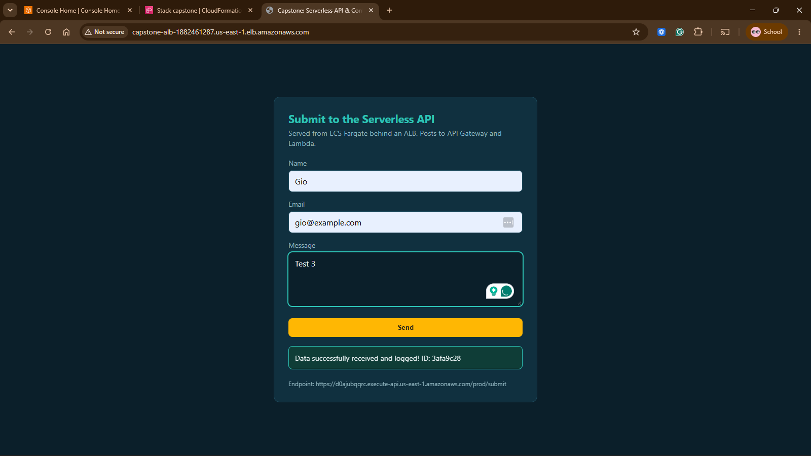
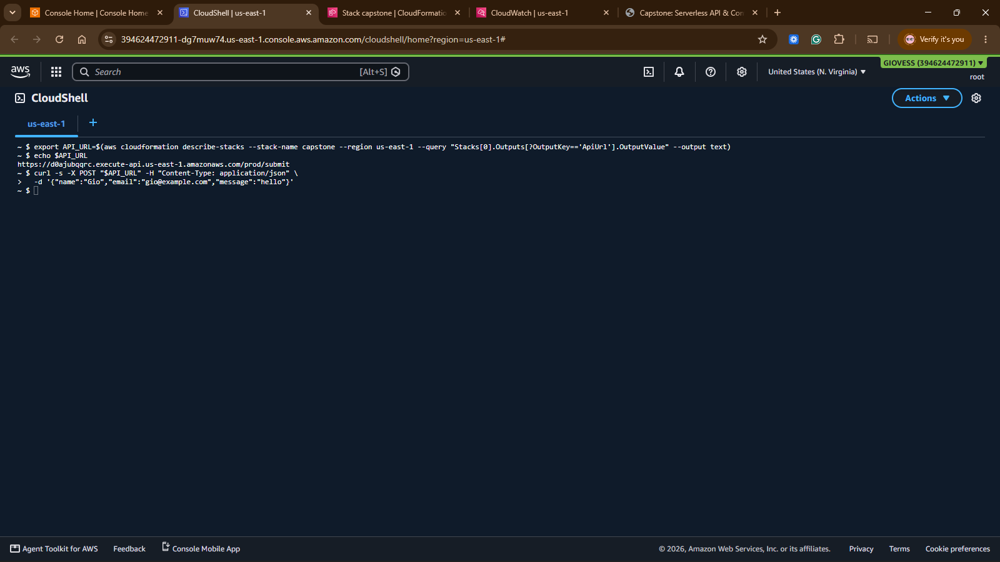
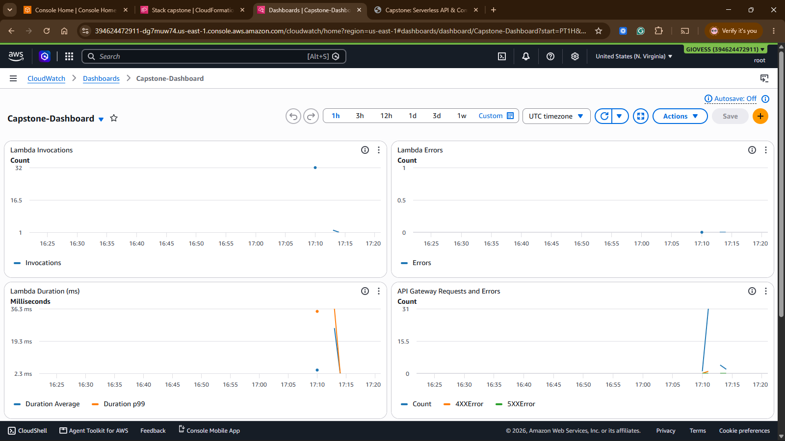
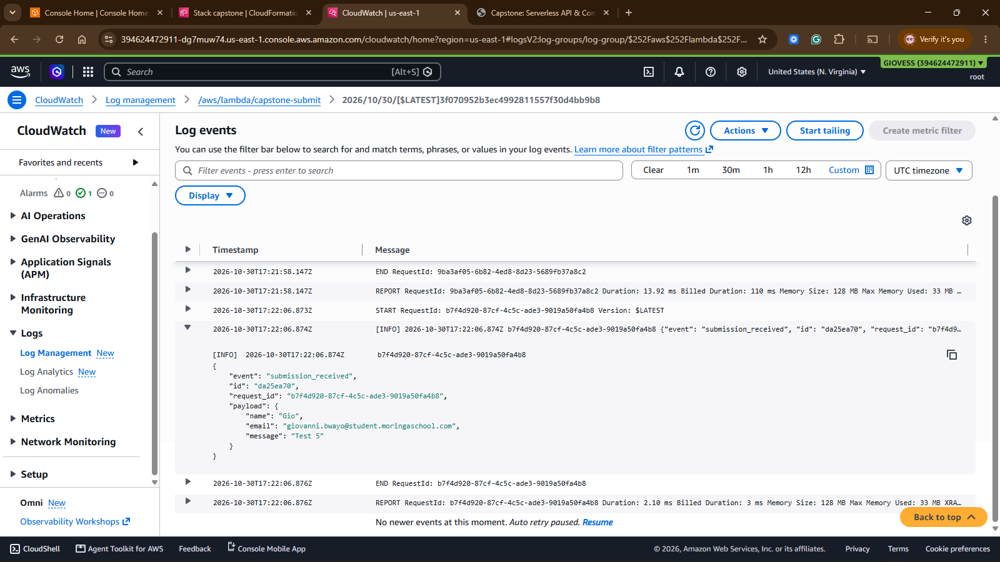

# Capstone 1: Serverless API and Containerized Web App

Hybrid cloud-native app on AWS (us-east-1): a serverless REST API receives data, a containerized web app on ECS Fargate submits to it, and CloudWatch provides observability.

## Architecture

```
Browser --> ALB --> ECS Fargate (nginx container, image in ECR)
   |
   +--POST /submit--> API Gateway (REST, prod) --> Lambda (Python 3.12) --> CloudWatch Logs
                                                          |
                                         CloudWatch Dashboard, Alarm, X-Ray
```

| Component | Detail |
|---|---|
| Web app | nginx:alpine serving a static form. API URL injected at container start via `API_URL` env var (`webapp/40-config.sh`) |
| Compute | ECS Fargate service behind an internet-facing ALB, Container Insights on, deployment circuit breaker with rollback |
| API | API Gateway REST `POST /submit` (Lambda proxy), `OPTIONS` mock for CORS |
| Lambda | `lambda-api/app.py`, validates JSON, logs structured payload, returns `{message, id}` |
| IaC | Single `infrastructure.yml`: VPC, ALB, ECS, Lambda, API Gateway, log groups, alarm, dashboard |

## Repository layout

```
infrastructure.yml
lambda-api/app.py
webapp/{Dockerfile,index.html,40-config.sh}
docs/screenshots/
```

## Deploy

```bash
export AWS_REGION=us-east-1
export ACCOUNT_ID=$(aws sts get-caller-identity --query Account --output text)
export ECR=$ACCOUNT_ID.dkr.ecr.$AWS_REGION.amazonaws.com

# 1. ECR repo, build, push
aws ecr create-repository --repository-name capstone-webapp --region $AWS_REGION
aws ecr get-login-password --region $AWS_REGION | docker login --username AWS --password-stdin $ECR
docker build --platform linux/amd64 -t capstone-webapp ./webapp
docker tag capstone-webapp:latest $ECR/capstone-webapp:latest
docker push $ECR/capstone-webapp:latest

# 2. Package Lambda code and deploy the stack
aws s3 mb s3://capstone-artifacts-$ACCOUNT_ID --region $AWS_REGION
aws cloudformation package --template-file infrastructure.yml \
  --s3-bucket capstone-artifacts-$ACCOUNT_ID --output-template-file packaged.yml
aws cloudformation deploy --template-file packaged.yml --stack-name capstone \
  --capabilities CAPABILITY_IAM --region $AWS_REGION \
  --parameter-overrides ImageUri=$ECR/capstone-webapp:latest

# 3. Outputs
aws cloudformation describe-stacks --stack-name capstone --query "Stacks[0].Outputs" --output table
```

## Test the API

```bash
curl -s -X POST "$API_URL" -H "Content-Type: application/json" \
  -d '{"name":"Gio","email":"gio@example.com","message":"hello"}'
```

Generate traffic for the dashboard:

```bash
for i in $(seq 1 30); do curl -s -X POST "$API_URL" -H "Content-Type: application/json" -d "{\"n\":$i}" > /dev/null; done
```

## Evidence

### 1. Live ECS web app


### 2. Successful API Gateway test


### 3. CloudWatch dashboard (Lambda invocations and errors)


### 4. CloudWatch Logs showing payloads


## Teardown

```bash
aws cloudformation delete-stack --stack-name capstone
aws ecr delete-repository --repository-name capstone-webapp --force
aws s3 rb s3://capstone-artifacts-$ACCOUNT_ID --force
```
